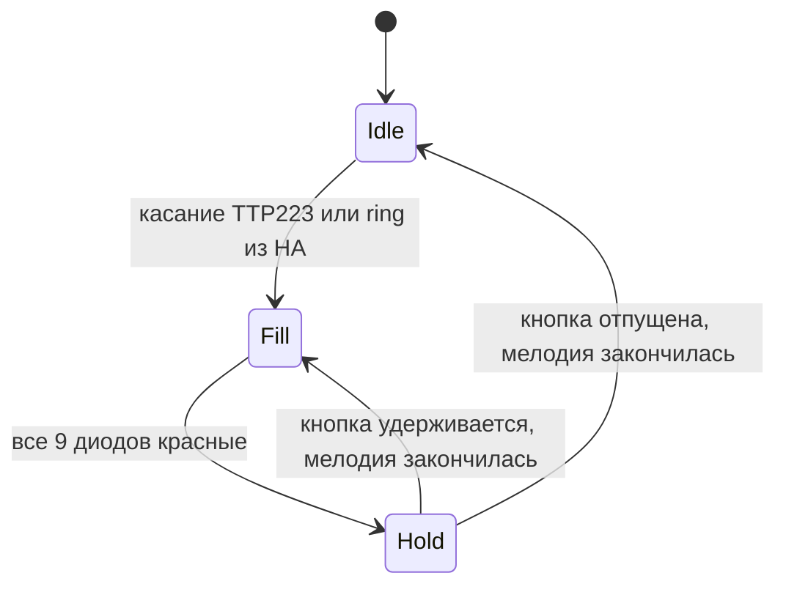

# SmartDoorBell на ESP32-C6

Умный дверной звонок: в простое адресная лента светится настраиваемым цветом, при касании сенсорной кнопки красная волна расходится от центра, а из динамика играет мелодия звонка. После отпускания кнопки текущий цикл доигрывается, затем лента возвращается к подсветке простоя.

## Возможности

- Подсветка простоя: включение, яркость и цвет задаются из Home Assistant через Zigbee.
- Настройки подсветки сохраняются в NVS и переживают перезагрузку.
- Сенсорная кнопка TTP223, антидребезг 40 мс.
- Симметричная анимация от центра: пары диодов загораются красным за 5 шагов по 100 мс.
- Удержание кнопки повторяет звонок; после отпускания текущий цикл доигрывается.
- Мелодия дверного звонка через MAX98357A и динамик.
- Анимация и звук работают параллельно и не блокируют друг друга.
- Мелодия хранится в LittleFS и легко заменяется без пересборки прошивки.
- Zigbee-роутер для Zigbee2MQTT: light, кнопка «Звонок», событие касания и OTA.
- Датчик `last_press` с датой и временем последнего нажатия или удалённого звонка.

## Аппаратура

| Компонент | Назначение |
|---|---|
| ESP32-C6 SuperMini | Основной контроллер |
| Адресная лента WS2812B, 9 светодиодов | Подсветка и анимация |
| TTP223 | Сенсорная кнопка |
| MAX98357A | I2S-усилитель с ЦАП |
| Динамик 4–8 Ом, 3 Вт и больше | Звук |
| Блок питания 5 В, 2–3 А | Питание всей системы |

## Схема подключения

### Адресная лента

| Лента | ESP32-C6 | Примечание |
|---|---|---|
| VCC / 5V | 5V | Питание 5 В |
| GND | GND | Общий провод |
| DIN | GPIO6 | Резистор 330–470 Ом последовательно в линию данных |

Рекомендуется поставить электролитический конденсатор 470–1000 мкФ между 5V и GND рядом с лентой.

### Сенсорная кнопка TTP223

| TTP223 | ESP32-C6 | Примечание |
|---|---|---|
| VCC | 3V3 | Питать от 3.3 В, чтобы выход не подал 5 В на GPIO |
| GND | GND | Общий провод |
| OUT | GPIO7 | Активный уровень HIGH |

По умолчанию TTP223 работает в режиме momentary: касание — HIGH, отпущено — LOW. Если на модуле перепаяны перемычки и логика инвертирована, поменяйте `kTouchActiveLevel` в `include/config.h`.

### Аудиомодуль MAX98357A

| MAX98357A | ESP32-C6 | Примечание |
|---|---|---|
| VIN | 5V | Питание усилителя |
| GND | GND | Общий провод |
| BCLK | GPIO18 | Тактирование I2S |
| LRC | GPIO19 | LRC / WS |
| DIN | GPIO20 | Данные I2S |
| SD | 3V3 | Включает усилитель, выбирает левый канал |
| GAIN | не подключать | Усиление по умолчанию около 9 дБ |
| + / − | динамик | Не соединять выходы динамика с GND или питанием |

Рядом с VIN усилителя желательно поставить конденсатор 470–1000 мкФ. Динамик подключается только к выходным контактам усилителя.

### Занятые и неудобные пины

| GPIO | Почему не использовать |
|---|---|
| GPIO4, GPIO5, GPIO8, GPIO9, GPIO15 | Strapping-пины |
| GPIO8 | Встроенный RGB-светодиод платы |
| GPIO9 | Кнопка BOOT |
| GPIO12, GPIO13 | Native USB |

## Как это работает



- В состоянии `Idle` все 9 диодов светятся цветом и яркостью из `light`-сущности.
- По фронту касания запускаются анимация и аудио.
- В состоянии `Fill` диоды загораются парами от центра к краям: 5 шагов по 100 мс.
- В состоянии `Hold` все диоды красные, пока играет мелодия.
- Если кнопка всё ещё удерживается после окончания мелодии, звонок и анимация повторяются.
- После отпускания кнопки текущий цикл не обрывается, а доигрывает до конца.
- Мелодия играет в отдельной задаче FreeRTOS, поэтому не задерживает анимацию.

## Аудио

Файл мелодии: `data/doorbell.wav`.

Требования к файлу:

- контейнер WAV (RIFF/WAVE);
- PCM без сжатия;
- 16 бит на сэмпл;
- моно или стерео;
- частота дискретизации 16 кГц (прошивка читает частоту из заголовка, но 16 кГц — оптимальный вариант).

Мелодия генерируется скриптом `tools/make_doorbell.py`: классический двухнотный «дин-дон» с затуханием, без сторонних аудиофайлов и лицензионных ограничений.

Генерация:

```bash
python3 tools/make_doorbell.py
```

Скрипту нужен `numpy`. Если его нет:

```bash
python3 -m pip install numpy
```

Проверить звук на macOS:

```bash
afplay data/doorbell.wav
```

Заменить мелодию своей:

1. Положите WAV в `data/doorbell.wav` с параметрами выше.
2. При необходимости конвертируйте, например через `afconvert` или `ffmpeg`.
3. Загрузите файловую систему в плату:

```bash
pio run -t uploadfs
```

Если файл отсутствует или формат неверный, лента продолжит работать, а в Serial Monitor появится сообщение об ошибке.

## Zigbee2MQTT и Home Assistant

Устройство работает как Zigbee-роутер. Основной endpoint — color dimmable light (On/Off, Level, Color, Identify), также используются кластеры Time и OTA client. On/Off client отправляет физическое нажатие в координатор. Внешний конвертер добавляет кнопку, событие и датчик времени.

### Сущности

| Сущность | Тип | Что делает |
|---|---|---|
| `light` | light | Включение, яркость и цвет подсветки простоя |
| `ring` | button | Запускает звонок через `genIdentify.identify` |
| `last_press` | sensor, `device_class: timestamp` | Время последнего физического касания или удалённого звонка |
| `action` | event | Событие `single` только при физическом касании |
| `update` | update | OTA-обновление прошивки через Zigbee2MQTT |

Кнопка в Home Assistant публикует в топик `zigbee2mqtt/<friendly_name>/set/ring` полезную нагрузку `ring`. Эквивалентная команда через общий топик:

```json
{"ring": "ring"}
```

Событие и время приходят в состояние устройства:

```json
{
  "action": "single",
  "last_press": "2026-11-03T18:42:10.000Z"
}
```

`last_press` обновляется и при физическом касании, и при удалённом звонке. `action` появляется только при физическом касании. Повторные срабатывания при удержании не обновляют `last_press`.

`action` становится event-сущностью Home Assistant только при включённом `experimental_event_entities: true` в конфигурации Zigbee2MQTT. Без этого событие всё равно доступно в MQTT и через автоматизации Z2M.

### Установка конвертера

1. В `configuration.yaml` Zigbee2MQTT включите event-сущности:

```yaml
homeassistant:
  experimental_event_entities: true
```

`enable_external_js` по умолчанию равен `true`; если он был отключён, включите его. Файлы из папки `external_converters` загружаются автоматически.

2. Скопируйте `zigbee2mqtt/smart-doorbell.mjs` в папку `external_converters` рядом с `configuration.yaml` Zigbee2MQTT.

3. Перезапустите Zigbee2MQTT и проверьте в логе строку `Loaded external converter 'smart-doorbell.mjs'`.

4. Включите `Permit join` и подайте питание на звонок. Устройство подключится как роутер.

5. После сопряжения нажмите на TTP223. В MQTT появятся `action` и `last_press`; в Home Assistant — `light`, `button`, `event`, `sensor` и `update`.

### Время

Прошивка запрашивает время у координатора через кластер `genTime` при старте и повторно раз в 6 часов. Синхронизация выполняется в отдельной задаче и не блокирует звонок и анимацию. В прошивке учтён баг библиотеки Zigbee 3.3.8: `getTime()` возвращает секунды эпохи Zigbee (с 2000 года) как Unix-время, поэтому к результату добавляется поправка 946684800 секунд.

Устройство отправляет `last_press` после успешной синхронизации времени. Удалённый звонок также обновляет `last_press`.

### OTA-обновление

В прошивке реализован Zigbee OTA client: Z2M скачивает образ на устройство, устройство записывает его во второй app-раздел, переключает загрузку и перезагружается. Настройки света в NVS сохраняются.

OTA-образы публикуются в GitHub Releases репозитория `AntennaNaStolbe/SmartDoorBell`. Первый раз прошивку с OTA-клиентом нужно залить по USB, дальше обновления идут по Zigbee.

#### Первичная прошивка

```bash
pio run
pio run -t upload
pio run -t uploadfs
```

После первичной прошивки не прошивайте OTA-версию повторно по USB: версия на устройстве станет равна версии в индексе, и Z2M не предложит обновление.

#### Выпуск обновления

1. Увеличьте `kFirmwareVersion` в `include/config.h`, например с `0x00010001` до `0x00010002`.
2. Соберите прошивку: `pio run`.
3. Сгенерируйте OTA-файл и индекс с абсолютным URL GitHub:

```bash
python3 tools/make_ota.py \
  --base-url https://github.com/AntennaNaStolbe/SmartDoorBell/releases/latest/download
```

`make_ota.py` читает `kFirmwareVersion`, `kOtaManufacturer`, `kOtaImageType` и `kOtaHardwareVersion` из `include/config.h`.

4. Создайте тег и релиз. Сначала загрузите образ, затем индекс:

```bash
git tag v1.0.2
git push origin v1.0.2

gh release create v1.0.2 \
  zigbee2mqtt/ota/DIY-SmartDoorBell.zigbee \
  --title "v1.0.2" \
  --notes "Zigbee OTA firmware 0x00010002"

gh release upload v1.0.2 zigbee2mqtt/ota/index.json
```

5. В `configuration.yaml` Zigbee2MQTT укажите постоянный URL индекса:

```yaml
ota:
  zigbee_ota_override_index_location: https://github.com/AntennaNaStolbe/SmartDoorBell/releases/latest/download/index.json
```

6. Перезапустите Z2M, откройте устройство → OTA → `Check for updates`. В Home Assistant у устройства появится сущность `update`.

Важно: `fileVersion` должен быть больше версии, сейчас запущенной на устройстве. `manufacturerCode` (`0x1A1A`), `imageType` (`0x0001`) и hardware version (`0x0001`) должны совпадать с прошивкой.

Файл OTA собирается в формате ZCL: 56-байтный обязательный заголовок + 4 байта hardware versions, 6-байтный заголовок элемента и сама прошивка. `index.json` содержит SHA-512 и размер файла. Локальный вариант с `zigbee_ota_override_index_location: ota/index.json` остаётся доступен, если файлы из `zigbee2mqtt/ota` скопированы в каталог данных Z2M.

### Сброс Zigbee

Удерживайте кнопку BOOT (GPIO9) на плате 5 секунд во время работы устройства. Прошивка выполнит сброс Zigbee-настроек и перезагрузится. Не удерживайте BOOT при включении питания: ESP32-C6 войдёт в режим загрузчика.

### Примечания по сборке

Для роутера используется раздел `zigbee_zczr.csv`, но в проекте лежит совместимый `partitions_zigbee_zczr.csv`. Он нужен из-за особенности PlatformIO: стандартный файл содержит дополнительные FAT-разделы Zigbee, и сборщик LittleFS ошибочно выбирает `zb_fct` вместо `spiffs`. В пользовательской таблице разделы Zigbee помечены числовыми subtype `0x81`/`0x82` (те же `fat`/`spiffs`), поэтому `spiffs` остаётся единственным разделом, который видит сборщик файловой системы. Смещения и размеры разделов совпадают со стандартной таблицей.

## Сборка и прошивка

Проект собран на PlatformIO. Плата определяется как `esp32-c6-devkitc-1`, потому что это совместимый board definition для ESP32-C6 SuperMini.

```bash
pio run
pio run -t upload
pio run -t uploadfs
pio device monitor -b 115200
```

После сборки OTA-образ и индекс можно обновить командой:

```bash
python3 tools/make_ota.py
```

Порядок важен: сначала прошивка, затем файловая система. `uploadfs` не стирает прошивку, но перезаписывает раздел LittleFS.

Если порт не появляется:

1. Используйте USB-C кабель с линиями данных, а не charge-only.
2. Зажмите BOOT, нажмите RESET, отпустите RESET, затем отпустите BOOT.
3. Проверьте другой USB-порт Mac.

На macOS устройство обычно видно как `/dev/cu.usbmodem*`.

## Настройки

Все основные параметры находятся в `include/config.h`:

| Параметр | Значение по умолчанию | Описание |
|---|---|---|
| `kLedPin` | 6 | Пин данных ленты |
| `kLedCount` | 9 | Количество светодиодов |
| `kMaxBrightness` | 255 | Яркость анимации звонка |
| `kDefaultIdleLevel` | 102 | Яркость простоя по умолчанию (шкала Zigbee) |
| `kDefaultIdleRed/Green/Blue` | 255 | Цвет простоя по умолчанию (белый) |
| `kTouchPin` | 7 | Вход TTP223 |
| `kTouchActiveLevel` | HIGH | Активный уровень касания |
| `kTouchDebounceMs` | 40 | Антидребезг |
| `kFactoryResetPin` | 9 | Кнопка BOOT для сброса Zigbee |
| `kFactoryResetHoldMs` | 5000 | Удержание для сброса |
| `kZigbeeEndpoint` | 1 | Endpoint Zigbee |
| `kTimeSyncRetryMs` | 10000 | Повтор синхронизации времени при ошибке |
| `kTimeResyncMs` | 6 часов | Период повторной синхронизации |
| `kFillStepMs` | 100 | Шаг анимации |
| `kAudioRestartTimeoutMs` | 300 | Ожидание остановки аудио перед повтором |
| `kSettingsSaveDelayMs` | 500 | Задержка сохранения настроек в NVS |
| `kSettingsNamespace` | `doorbell` | Namespace NVS |
| `kFirmwareVersion` | `0x00010001` | Версия прошивки для OTA |
| `kOtaManufacturer` | `0x1A1A` | Manufacturer code OTA |
| `kOtaImageType` | `0x0001` | Image type OTA |
| `kOtaHardwareVersion` | `0x0001` | Hardware version OTA |
| `kI2sBclkPin` | 18 | I2S BCLK |
| `kI2sLrcPin` | 19 | I2S LRC |
| `kI2sDinPin` | 20 | I2S DIN |
| `kDoorbellPath` | `/doorbell.wav` | Путь к мелодии в LittleFS |

Настройки света меняются из HA и сохраняются автоматически. Сброс Zigbee кнопкой BOOT также очищает настройки света и возвращает белый цвет с яркостью 40%.

## Питание и безопасность

- Используйте общий GND для ESP32, ленты, TTP223 и усилителя.
- Для 9 светодиодов и усилителя рекомендуется блок питания 5 В на 2–3 А.
- Не подавайте 5 В на пин `5V` одновременно с подключённым USB.
- Не подключайте динамик к питанию или GND напрямую.
- TTP223 питайте от 3.3 В, чтобы его выход не превысил допустимое напряжение GPIO.
- Если лента мерцает, проверьте общий GND, добавьте резистор в линию данных и конденсатор по питанию.

## Диагностика

| Проблема | Что проверить |
|---|---|
| Плата не определяется | Кабель data, BOOT+RESET, другой USB-порт, драйверы не нужны |
| Нет звука | Питание MAX98357A, SD на 3V3, файл `doorbell.wav` загружен через `uploadfs`, динамик подключён к выходам усилителя |
| Лента не горит | Питание 5 В, общий GND, GPIO6, направление DIN |
| Лента мерцает | Общий GND, резистор 330–470 Ом, конденсатор 470–1000 мкФ, короткие провода |
| Ложные касания | Питание TTP223 3.3 В, общий GND, калибровка после включения, расстояние до металла |
| Плата перезагружается при звуке | Слишком слабый блок питания, добавьте конденсаторы, используйте 5 В 3 А |
| Не появляется в Zigbee2MQTT | `Permit join`, установленный конвертер, `enable_external_js: true`, сброс Zigbee кнопкой BOOT |
| Нет `last_press` | Проверьте загрузку конвертера и синхронизацию времени Zigbee |
| Кнопка `ring` не работает | Конвертер загружен, модель `SmartDoorBell`, MQTT-топик `/set`, статус сопряжения |
| Нет сущности `action` | Включите `homeassistant.experimental_event_entities: true` и перезапустите Z2M |
| Нет сущности `update` | Проверьте `ota.zigbee_ota_override_index_location`, доступность `index.json`, совпадение manufacturer/image type и версию выше текущей |
| OTA не начинается | Увеличьте `kFirmwareVersion`, пересоберите образ и `index.json`; проверьте лог `OTA:` в Serial Monitor |
| OTA обрывается | Проверьте питание, размер образа не больше `0x140000`, стабильность Zigbee-сети |
| `buildfs` падает с `LFS_ERR_NOSPC` | Используется `partitions_zigbee_zczr.csv`, а не стандартный `zigbee_zczr.csv` |

## Структура проекта

```text
SmartDoorBell/
├── include/
│   ├── config.h
│   ├── audio_player.h
│   ├── doorbell_zigbee.h
│   ├── light_settings.h
│   └── ota_update.h
├── src/
│   ├── main.cpp
│   ├── audio_player.cpp
│   ├── doorbell_zigbee.cpp
│   └── ota_update.cpp
├── data/
│   └── doorbell.wav
├── tools/
│   ├── make_doorbell.py
│   └── make_ota.py
├── zigbee2mqtt/
│   ├── smart-doorbell.mjs
│   └── ota/
│       ├── DIY-SmartDoorBell.zigbee
│       └── index.json
├── partitions_zigbee_zczr.csv
├── platformio.ini
├── README.md
└── .gitignore
```

## Примечания

- Мелодия синтезируется локально, сторонние аудиофайлы не используются.
- Прошивка использует Adafruit NeoPixel, встроенные ESP_I2S и Zigbee.
- Анимация и звук неблокирующие: лента продолжает работать, пока играет звонок.
- Zigbee-стек работает как роутер; для прошивки нужен раздел `zigbee_zczr` и флаги `ZIGBEE_MODE_ZCZR`.
- Внешний конвертер Z2M использует стандартные кластеры, без кастомных cluster-команд.
